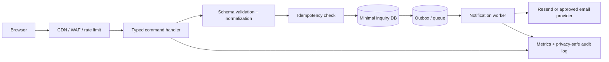

# Cynbit Backend Technical Audit

**Prepared for:** Backend Developer Intern challenge  
**Target:** Cynbit Technologies public website, [https://www.cynbit.in/](https://www.cynbit.in/)  
**Observation date:** 2026-11-02  
**Assessment mode:** Passive and publicly observable only

## Executive conclusion

Cynbit presents a modern Next.js application delivered through Vercel. The public site exposes a server-rendered marketing surface, a contact inquiry flow, a newsletter flow, a large careers/application flow, and a published route inventory. The most useful backend opportunity is to treat public submissions as untrusted, abuse-prone workflows rather than simple email forms: validate at the server boundary, apply quotas and idempotency, minimize stored personal data, isolate email and database side effects, and return stable non-sensitive errors.

This assessment did not establish a confirmed compromise or exploitable defect. It identifies observable control gaps and verification priorities. Claims about database access, authentication, rate limiting, authorization, queueing, and monitoring require authorized server-side review.

## 1. Observed architecture and public surface

The home page and response headers identify Vercel as the serving platform. The HTML references Next.js static chunks under `/_next/static/`, and the response includes Next.js router-related `vary` headers. This is consistent with a Next.js App Router deployment, although the public surface cannot prove the full origin architecture.

The public sitemap contains marketing, product, blog, case-study, careers, privacy, terms, and cookie routes. `robots.txt` allows crawling generally and lists `/api/`, `/admin/`, and `/portal/` as disallowed. This is a useful SEO boundary, but it is not an access-control mechanism: a disallowed path remains publicly addressable unless the application and edge layer enforce authorization.

The contact page renders a form with required `fullName`, `email`, and `message` fields plus optional `company` and `industry`. Its route bundle constructs a `FormData` object and invokes a Next.js server action named `submitInquiry`; no public REST path is visible in the inspected contact bundle. The browser displays a generic failure message and a success state after the action returns.

The careers page requests substantially more sensitive applicant data than the contact page, including phone and WhatsApp numbers, date of birth, gender, permanent address, education history, score, skills, portfolio links, LinkedIn, and an application statement. This creates a higher data-protection and retention burden than an ordinary marketing inquiry.

Cynbit's privacy page states that it collects minimum information, uses information to communicate about requests, uses Resend for email delivery and Prisma for database management, and supports access/deletion requests. The cookie page describes essential, analytics, and functional cookies, including a statement that analytics may use Google Analytics. These statements should be mapped to an actual data inventory and retention policy.

## 2. Findings

### F-01 — Public route exclusions are not security controls

**Category:** Security architecture  
**Severity:** Medium design risk; not a confirmed vulnerability  
**Evidence:** `robots.txt` disallows `/api/`, `/admin/`, and `/portal/` while the sitemap publishes a broad route inventory.

Robots directives control crawler behavior, not human or programmatic access. If `/admin/`, `/portal/`, or future API routes are sensitive, they need authentication, authorization, network controls where appropriate, and safe responses independent of crawler directives. The published existence of these route families also creates an inventory-management obligation.

**Recommendation:** Keep `robots.txt` focused on indexing. Enforce route-level authorization in middleware and at each handler. Return consistent `401`/`403` responses, avoid leaking whether privileged resources exist, and maintain an internal inventory of deployed API versions and server actions.

### F-02 — The contact workflow has an observable server action but no public contract

**Category:** API design and operability  
**Severity:** Medium opportunity/risk  
**Evidence:** The contact bundle invokes `submitInquiry` with `FormData`; the HTML form has no action URL or method attribute.

Server actions can be a good fit for a same-origin form, but they make an explicit API contract, independent integration, contract testing, and observability less obvious to reviewers and future clients. A stable command boundary should define accepted fields, size limits, validation errors, correlation IDs, and idempotency behavior even when the transport is a framework server action.

**Recommendation:** Keep the server action if it is the intended product boundary, but wrap it with a typed input schema and a documented command contract. Alternatively expose a versioned `POST /api/v1/inquiries` endpoint if integrations are expected. Do not return provider or database error details to the browser.

### F-03 — Public submission flows need explicit abuse controls

**Category:** Security, availability, and cost control  
**Severity:** High verification priority; not confirmed from passive evidence  
**Evidence:** The contact and newsletter UI are public and have side effects described by the UI and privacy policy. The inspected contact form has no visible CAPTCHA or client-side anti-automation control. Client-side controls are not sufficient by themselves, so this is a server-side verification priority rather than a claim that rate limiting is absent.

A public inquiry can trigger email delivery, database writes, CRM actions, or notifications. Without server-side quotas, bot detection, deduplication, and bounded payloads, automated use can consume provider quota, fill storage, or create an inbox-abuse problem. OWASP classifies unrestricted resource consumption and unrestricted access to sensitive business flows as API risks [6].

**Recommendation:** Enforce per-IP and per-identity rate limits at the edge and application layers, use a short-lived challenge only when risk signals justify it, cap field lengths and request body size, normalize duplicate submissions, and make downstream email delivery asynchronous. Record a privacy-safe audit event with a correlation ID.

### F-04 — Input validation and payload limits are not observable at the client boundary

**Category:** Data validation  
**Severity:** Medium  
**Evidence:** The contact page exposes required fields and HTML email typing, but the inspected markup does not expose `maxlength`, `pattern`, or a documented API schema. Browser validation is bypassable and does not protect the server.

Server validation should reject blank or overlong values, normalize Unicode and whitespace, validate email syntax with a pragmatic policy, and ensure that optional values are either absent or bounded strings. The careers flow needs stricter rules for dates, URLs, enumerations, education records, and score ranges. Any HTML rendering of user-controlled content must use context-aware output encoding.

**Recommendation:** Define a schema at the server boundary. Reject unexpected fields, cap body size, use an allowlist for enum values, validate URLs against an explicit policy, and store normalized values separately from the original display value when auditability requires both.

### F-05 — Sensitive applicant data requires minimization and lifecycle controls

**Category:** Privacy and data handling  
**Severity:** High governance priority  
**Evidence:** The careers form requests date of birth, gender, permanent address, contact numbers, education records, and application narrative. The privacy page promises minimum collection and deletion requests [2] [4].

The combination of sensitive fields and a stated minimum-collection principle creates a design question: which fields are necessary at initial screening, which can be optional, and how long are they retained? Sending full application payloads through email would increase exposure and make deletion and access fulfillment harder.

**Recommendation:** Separate recruitment intake from marketing inquiries. Collect only fields needed for the next decision, make nonessential demographic data optional or move it to a separately governed form, encrypt sensitive columns, restrict staff access by role, avoid putting full payloads in logs or email, define retention/deletion jobs, and document processor/subprocessor boundaries for Resend and Prisma.

### F-06 — Security headers should be made explicit and regression-tested

**Category:** Security configuration  
**Severity:** Medium  
**Evidence:** In a passive `GET` of the home and contact pages, `Strict-Transport-Security` was present. The inspected responses did not include `Content-Security-Policy`, `X-Frame-Options`, `Permissions-Policy`, or `Referrer-Policy` headers.

Header absence in the observed responses is worth fixing, but it is not proof of a browser exploit. CSP can restrict where scripts, frames, images, styles, and connections may load; MDN describes it as a mechanism to control allowed resources and help guard against cross-site scripting [7]. Frame protection and referrer policy should be selected deliberately for the site's embedding and analytics needs.

**Recommendation:** Add a tested baseline appropriate for Next.js, beginning with `Content-Security-Policy-Report-Only`, then enforce after resolving violations. Add `frame-ancestors 'none'` or an explicit allowlist, `Referrer-Policy: strict-origin-when-cross-origin`, `Permissions-Policy` with only required capabilities, and `X-Content-Type-Options: nosniff`. Ensure headers are applied consistently at the CDN, application, and error-page layers.

### F-07 — Cache semantics should be reviewed for dynamic or personalized responses

**Category:** Performance and data safety  
**Severity:** Medium verification priority  
**Evidence:** Public HTML responses returned `Cache-Control: public, max-age=0, must-revalidate` and weak ETags. The site also uses Next.js router-related `vary` headers.

This is not inherently incorrect. However, any future personalized, form-result, or authenticated response must never be publicly cacheable. Static marketing pages can benefit from explicit immutable asset caching and carefully chosen revalidation. Dynamic server-action responses need a clear no-store policy where user-specific data is involved.

**Recommendation:** Classify responses as public-static, public-revalidated, or private-dynamic. Apply `no-store` to authenticated and submission-result responses, use immutable caching for fingerprinted assets, and add cache-safety tests that assert no sensitive content is served from shared caches.

### F-08 — Observability should cover the complete submission path

**Category:** Reliability and operations  
**Severity:** Medium opportunity  
**Evidence:** The contact UI exposes only a generic error message and a success state. Public pages cannot show whether the backend uses retries, queues, dead-letter handling, or structured logs.

A generic browser message is good for avoiding information leakage, but operators still need a correlation ID, outcome metrics, provider latency, retry counts, and a dead-letter path. Email providers and databases should be treated as separate failure domains.

**Recommendation:** Generate a request ID at the edge, propagate it through validation, persistence, queue, and email delivery, and return only the ID plus a user-safe message. Emit structured events without raw message bodies, alert on error-rate and provider-latency thresholds, and make retries idempotent.

## 3. Proposed target architecture

The recommended flow is: edge protection receives the request; a typed command handler validates and normalizes it; an idempotency key prevents duplicate processing; a minimal inquiry record is written transactionally; an outbox or queue publishes a notification job; a worker calls the email provider; and metrics/logs capture only metadata needed for operations.

## 4. Reference implementation decisions

The included TypeScript example demonstrates the important boundaries rather than claiming to be Cynbit's stack. It validates on the server, strips unknown fields, bounds the request, uses a stable error envelope, and separates persistence from notification. A production implementation should add a real distributed limiter, a database-backed idempotency key, authenticated administrative access, secret management, and tests.

For future authenticated APIs, the included authorization example follows deny-by-default behavior and checks both the user's role and the resource owner. This directly addresses the object-level and function-level authorization concerns highlighted in the OWASP API Security Top 10 [6].

## 5. Prioritized implementation plan

**First 48 hours:** confirm the actual deployment topology; inventory server actions, API versions, email/database processors, and logs; add server-side schemas, body-size limits, rate limits, and correlation IDs to public submission flows; verify that sensitive responses are not cacheable.

**Next sprint:** introduce an outbox/queue for notifications, idempotency keys, structured metrics, dead-letter handling, retention/deletion jobs, and a data classification for contact versus recruitment records. Add automated response-header and authorization regression tests.

**Before expanding APIs or portals:** publish internal OpenAPI or typed contracts, maintain an endpoint/version inventory, run an authorized threat model, review access-control tests for every object identifier, and perform a bounded staging assessment with written approval.

## 6. Verification plan for authorized access

1. Review server-action and API source, middleware, database schema, and deployment configuration.
2. Confirm schema validation, maximum body sizes, rate limits, idempotency behavior, and safe error envelopes in staging.
3. Test authorization with test tenants and synthetic records only; verify both object- and function-level controls.
4. Confirm logs, traces, metrics, retries, and dead-letter behavior without recording personal payloads.
5. Verify retention, deletion, access-request fulfillment, processor contracts, and cache behavior using synthetic data.
6. Run a limited security test under a written scope and stop conditions. Do not test production without explicit authorization.

## References

[1]: https://www.cynbit.in/ "Cynbit Technologies public home page"
[2]: https://www.cynbit.in/contact "Cynbit Technologies contact page"
[3]: https://www.cynbit.in/services "Cynbit Technologies services page"
[4]: https://www.cynbit.in/privacy "Cynbit Technologies privacy policy"
[5]: https://www.cynbit.in/careers/backend-developer-intern "Cynbit Technologies backend developer intern page"
[6]: https://owasp.org/API-Security/editions/2023/en/0x11-t10/ "OWASP Top 10 API Security Risks 2023"
[7]: https://developer.mozilla.org/en-US/docs/Web/HTTP/Reference/Headers/Content-Security-Policy "MDN Content-Security-Policy header"
[8]: https://www.cynbit.in/robots.txt "Cynbit Technologies robots.txt"
[9]: https://www.cynbit.in/sitemap.xml "Cynbit Technologies sitemap.xml"
[10]: https://www.cynbit.in/terms "Cynbit Technologies terms of service"
[11]: https://www.cynbit.in/cookies "Cynbit Technologies cookie policy"
